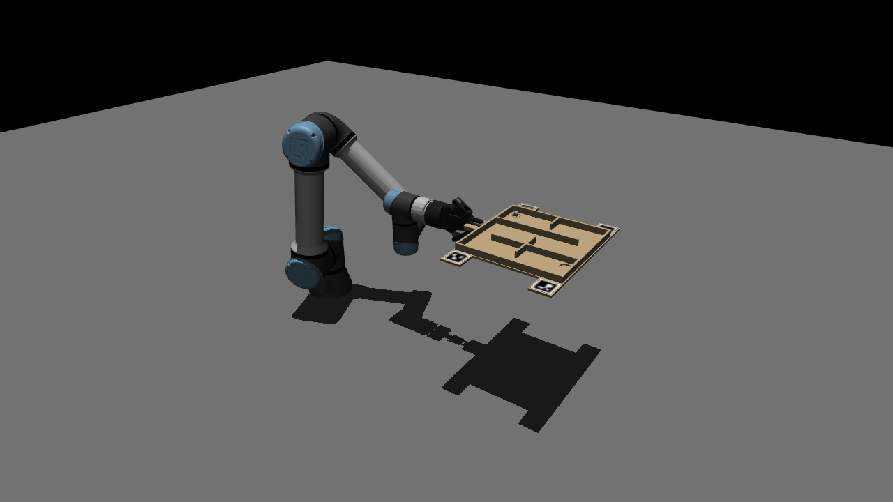
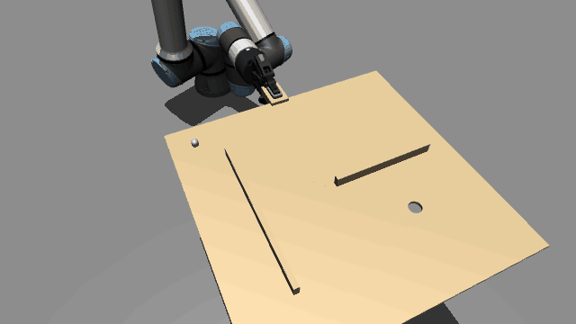

# ee206-project: UR7e ball-in-maze

EECS C106A / C206A final project. A UR7e holds a maze board by its edge and tilts it to roll a ball from start to goal as fast as possible without dropping it into a hole. An overhead webcam maps the maze and tracks the ball; the pipeline is developed in a MuJoCo simulation behind the same ROS 2 interface as the robot.

## Team

| Name | Email |
|---|---|
| TienChun (Leo) Chen | leotcchen@berkeley.edu |
| Jing Xu | jing_xu1112@berkeley.edu |
| Chelsea Yan | chelseayan@berkeley.edu |
| Zhuoren Li | gabriel.li@berkeley.edu |
| Steven Wu | chiachien_wu@berkeley.edu |

## Links

- Proposal: [`proposal/206A_Final_Project_Proposal.pdf`](proposal/206A_Final_Project_Proposal.pdf) (source: [`proposal/main.md`](proposal/main.md))
- Work plan and task status: [GitHub Project board](https://github.com/users/leokim10073/projects/1)

## Branches and commits

Work happens on `feat/<area>` branches and merges into `main` through pull requests.

Start every commit title with the area in brackets, for example `[proposal] switch project to UR7e ball-in-maze` or `[sim] add ball friction`.

## Development environment (distrobox)

Everything runs inside one container, so nothing is installed on your machine. You only need [podman](https://podman.io) (or Docker) and [distrobox](https://distrobox.it).

Build the image and create the container once:

```bash
./docker/build.sh
distrobox assemble create --file docker/distrobox.ini
```

Enter it whenever you work on the project:

```bash
distrobox enter maze-sim
```

Your home directory is shared with the container, so the repo is at the same path inside. ROS 2 Humble is already sourced. The container does not write your dotfiles or `~/.local`; it sets `PYTHONNOUSERSITE=1` so Python packages from your own `~/.local` do not override the image's.

An NVIDIA GPU is used for the sim camera if present. `distrobox enter` reads your `~/.bashrc`, so an `RMW_IMPLEMENTATION` set there applies inside too; the image has both Fast DDS (the Humble default) and Cyclone DDS, and the tests pass on both. Use the same one as the robot's computer.

The prompt looks the same inside and outside the container, because distrobox keeps your hostname and `~/.bashrc`. `echo ${CONTAINER_ID:-host}` prints `maze-sim` inside. Running `distrobox enter` again from inside fails with "we need a container manager".

After `docker/` changes (yours or from a `git pull`), rebuild and recreate; an existing container keeps the old image:

```bash
distrobox rm -f maze-sim && ./docker/build.sh && distrobox assemble create --file docker/distrobox.ini
```

## Simulation

A MuJoCo scene of the lab UR7e holding the maze board with its Robotiq 2F-85, plus an overhead camera, behind the same ROS 2 interface as the real robot. Lab code switches between sim and robot by changing the launch file, not the code. The design is in [`docs/superpowers/specs/2026-11-08-simulation-s1-design.md`](docs/superpowers/specs/2026-11-08-simulation-s1-design.md).



*The start pose after the automatic reset, rendered from the sim's own MuJoCo scene. The board is a placeholder until the CAD export (below) arrives.*

### Prerequisites

The `maze-sim` container from [Development environment](#development-environment-distrobox) holds ROS 2 Humble, MuJoCo, `mujoco_ros2_control` and every Python package the sim needs.

### Build and run (inside `maze-sim`)

```bash
source /opt/ros/humble/setup.bash
colcon build
source install/setup.bash
ros2 launch maze_sim_bringup sim.launch.py
```

| Argument | Default | Meaning |
|---|---|---|
| `config` | `maze_sim_description/config/sim.yaml` | Scene and camera configuration |
| `viewer` | `true` | Open the MuJoCo viewer; `false` runs headless |
| `camera` | `true` | Render and publish the overhead camera |

The launch validates `sim.yaml` first and stops with a message naming the bad key. A few seconds after start, the sim runs one `/sim/reset` so the gripper is squeezing the handle and the ball sits at rest on a level board; `/sim/reset_done` (latched) says when that is done.

**Speed.** Every 10 s the sim logs `real-time factor: <x.xx>` (sim time ÷ wall time). On the owner's machine (RTX 5070 Ti) with `viewer:=true camera:=true` it reads **1.00**. If your machine cannot keep up, sim time slows down evenly (no physics steps are skipped) and the log warns. Lab-style nodes that run on the wall clock then see the arm move less per second than on the robot; close other programs or launch with `camera:=false`.

### Try it

Leave the launch running and open a second terminal on the host. Every terminal that talks to the sim needs the same `RMW_IMPLEMENTATION` and `ROS_DOMAIN_ID` as the one running it, which holds when both come from your `~/.bashrc`.

```bash
distrobox enter maze-sim
cd <repo> && source install/setup.bash
```

Overhead camera image:

```bash
ros2 run rqt_image_view rqt_image_view /camera/image_raw
```

Open the gripper (answers `opened`; the board falls), then put everything back (~1.5 s):

```bash
ros2 service call /toggle_gripper std_srvs/srv/Trigger
ros2 service call /sim/reset std_srvs/srv/Trigger
```

Velocity control, as the lab does it: switch from the trajectory controller to the velocity controller, then stream joint velocities (rad/s, in `/joint_states` order). The last entry turns `wrist_3`, which tilts the board about its x axis, so the ball rolls. Ctrl-C stops publishing and the arm stops.

```bash
ros2 control switch_controllers --deactivate scaled_joint_trajectory_controller --activate forward_velocity_controller
ros2 topic pub -r 50 /forward_velocity_controller/commands std_msgs/msg/Float64MultiArray "{data: [0, 0, 0, 0, 0, 0.1]}"
```



*Recorded from the sim through ROS: `wrist_3` at −0.1 rad/s for 0.5 s, +0.1 rad/s for 1 s, −0.1 rad/s for 0.5 s (a 3° tilt each way). Rendered from the recorded joint and pose topics with the sim's MuJoCo scene.*

Back to the trajectory controller (lab 3 and lab 7 use it):

```bash
ros2 control switch_controllers --deactivate forward_velocity_controller --activate scaled_joint_trajectory_controller
```

### Interfaces

Same names and types as the lab UR7e.

| Name | Type | Notes |
|---|---|---|
| `/joint_states` | `sensor_msgs/JointState` | The 6 UR joints only, 500 Hz |
| `/forward_velocity_controller/commands` | `std_msgs/Float64MultiArray` | 6 joint velocities, rad/s (inactive at start) |
| `/forward_position_controller/commands` | `std_msgs/Float64MultiArray` | 6 joint positions, rad (inactive at start) |
| `/scaled_joint_trajectory_controller/joint_trajectory` | `trajectory_msgs/JointTrajectory` | Active at start (lab 3) |
| `/scaled_joint_trajectory_controller/follow_joint_trajectory` | action `control_msgs/FollowJointTrajectory` | Lab 7 |
| `/controller_manager/*` | `controller_manager_msgs` services | `ros2 control switch_controllers` works unchanged |
| `/tf`, `/tf_static` | `tf2_msgs/TFMessage` | `world` → `base_link` → … → `tool0`, and `world` → `camera_optical_frame` |
| `/toggle_gripper` | `std_srvs/Trigger` | Opens a closed gripper or closes an open one (lab 5); answers `opened` / `closed`. Opening drops the board |
| `/camera/image_raw` | `sensor_msgs/Image` | `rgb8`, 1280×720 at 60 fps by default (C922 model) |
| `/camera/camera_info` | `sensor_msgs/CameraInfo` | Pinhole intrinsics from resolution and `hfov_deg`, zero distortion |

Sim only, no robot equivalent:

| Name | Type | Notes |
|---|---|---|
| `/sim/ball/pose`, `/sim/board/pose` | `geometry_msgs/PoseStamped` | Ground truth in `world`, 100 Hz, for checking perception |
| `/sim/reset` | `std_srvs/Trigger` | Arm to `initial_joints`, gripper closed, board in the grasp, ball at `ball.start`, at rest (~1.5 s) |
| `/sim/reset_done` | `std_msgs/Empty` (latched) | Published after each reset |
| `/sim/camera/depth` | `sensor_msgs/Image` | Float depth, m |
| `/clock` | `rosgraph_msgs/Clock` | Sim time; every sim node runs with `use_sim_time:=true` |

Things that differ from the robot, on purpose or by the simulator:

- The camera publishes at 62.5 Hz (frames land on whole 2 ms physics steps). A slow subscriber of the 2.7 MB images can miss some (a Python subscriber gets ~56 Hz, less on a busy machine), because the publisher keeps only the newest frame. A GPU that cannot render a frame within its slot publishes fewer (an Intel Iris Xe gets ~55 Hz in sim time), and the sim logs `camera at <x> fps (sim time), below camera.fps`.
- `camera_info` puts the principal point at (w/2, h/2), half a pixel off the ROS pixel-centre convention.
- While the gripper is closed on the board, a weld holds the board in the grasp (`GraspWeldPlugin` in `maze_sim_nodes`). MuJoCo's friction is soft, so a board held by contacts alone creeps out of the grasp (about 0.014°/s while the arm moves, whatever the friction or finger force), where the real pads would not. The weld switches on only for a board within 5 mm and 3° of its grasp pose, and off as soon as the gripper opens, so dropping and regrasping still go through contacts and gravity. Held, the board still flexes up to ~0.6 mm / 0.2° against the fingers.
- Physics and the controllers run on separate threads, so the same command sequence after `/sim/reset` gives the same ball path to within ~2 mm while the ball rolls free; after the ball hits walls, runs differ by up to ~1 cm, as on real hardware.

### Board export (Steven)

MuJoCo cannot read STEP, so export the board from CAD as STL. `maze_CAD/scripts/export_sim.py --level <L>` does this and writes the parts to `maze_CAD/levels/<L>/sim/` (see [`maze_CAD/README.md`](maze_CAD/README.md)):

| Part | File | Use in the sim |
|---|---|---|
| Base plate with holes | `base.stl` | Convex-decomposed (CoACD) so the holes stay open; also the visual |
| Handle | `handle.stl` | Convex-decomposed; the fingers grip it |
| Each wall | `wall_<n>.stl`, one per wall | Collides as its convex hull, so each wall must be one straight box: split an L-shaped or bent wall into straight pieces, or it fills its corner |
| Shallow pocket (e.g. the goal) | a through hole in `base.stl` plus a convex `wall_<n>.stl` disk as its floor | CoACD fills a pocket that does not go through, and the ball rolls over it |
| ArUco stickers (optional) | `aruco/aruco_<corner>.obj` + `.png` | Drawn with their texture, never collide |
| Goal hole | center and radius | Typed into `sim.yaml` (`board.goal_hole`); `parts_report.json` has the values |

All parts in one shared frame: origin at the board center, z up, z = 0 on the maze floor (the plate's top face), so the ball spawns at z = ball radius. State the units. Then convert (inside `maze-sim`):

```bash
build_board_assets maze_CAD/levels/L1/sim --units mm --out-dir src/maze_sim_description/meshes/board
colcon build
```

The tool replaces every mesh and marker texture in `--out-dir` and writes `board.json`, which lists the meshes the sim loads and the units they came from. Set `board.units` in `sim.yaml` to the same units: the launch refuses a mismatch, and refuses a board whose size is 1000× off, both with a message about `board.units`.

### `sim.yaml` reference

[`src/maze_sim_description/config/sim.yaml`](src/maze_sim_description/config/sim.yaml) holds every adjustable value; all keys are required.

| Key | Meaning |
|---|---|
| `camera.position`, `look_at`, `up` | Camera pose in `world` (m); `up` is the world direction shown as image up, must not be parallel to the view direction |
| `camera.resolution`, `fps`, `hfov_deg` | Image size, rate and horizontal field of view |
| `robot.ur_type`, `initial_joints` | UR model and start/reset joint angles (rad); the default holds the board level |
| `gripper.closed_position`, `force_limit` | Finger closure at the handle (0–1) and grip force (N) |
| `board.mesh_dir`, `units` | Converted board meshes (`package://`, absolute, or relative to `sim.yaml`) and the STL units |
| `board.grasp_offset` | Handle frame relative to `tool0` (`xyz` m, `rpy` rad) |
| `board.mass`, `surface_friction`, `goal_hole` | Board mass (kg), felt friction (sliding, torsional, rolling), goal hole in the board frame |
| `ball.radius`, `mass`, `start`, `friction` | Steel ball; `start` is xy in the board frame |
| `physics.timestep`, `real_time_factor`, `noslip_iterations` | 2 ms steps, target speed (1.0 = wall clock), grasp contact solver iterations |

### Tests (inside `maze-sim`)

```bash
colcon build && source install/setup.bash
python3 -m pytest src/maze_sim_description/test
cd src/maze_sim_bringup && python3 -m pytest test
```

The bringup tests launch the whole sim headless (about 70 s). They refuse to start while another sim is running, since it would answer the same services; stop it first. The sim's process can print a segfault on shutdown; that is an upstream `mujoco_ros2_control` bug and harmless.
